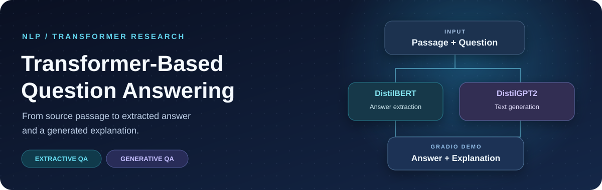
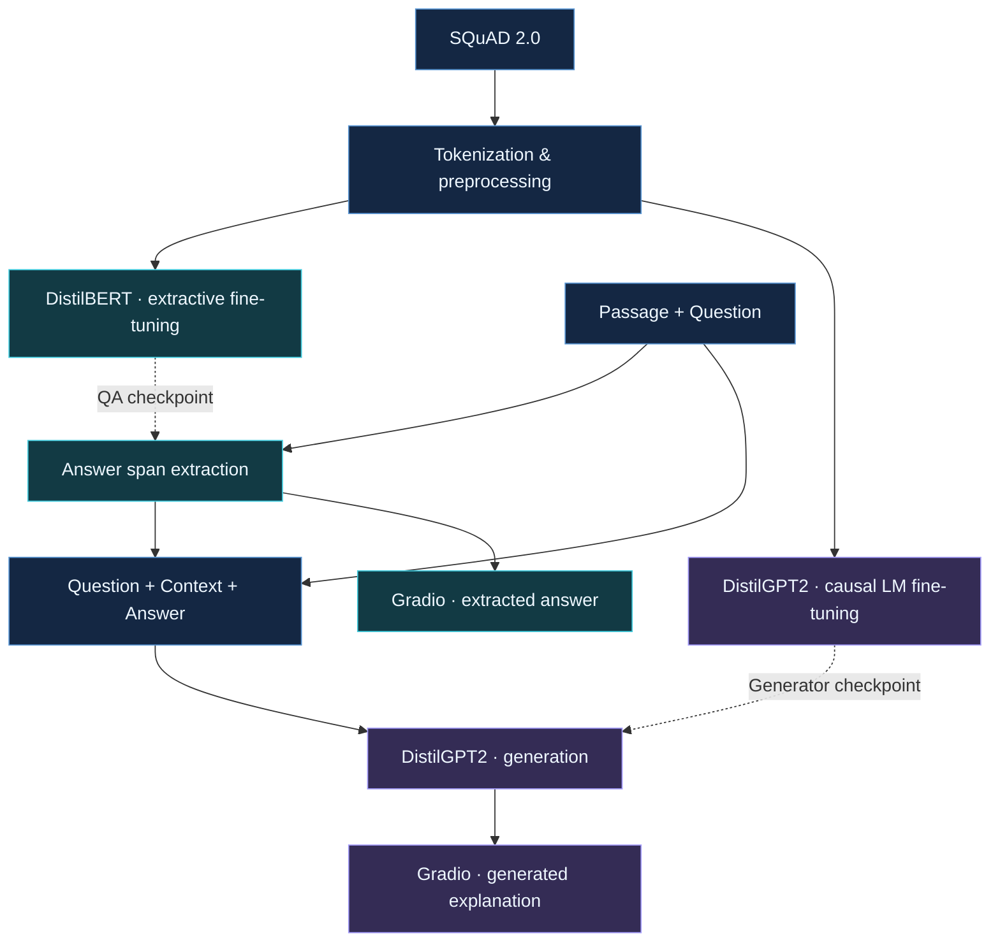
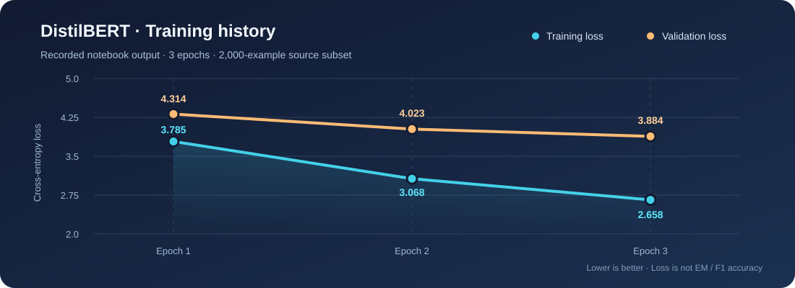

<div align="center">
  

  <br />

  <p><strong>A two-stage Transformer NLP project for answer extraction, conditioned text generation, and model experimentation.</strong></p>

  <p>
    
    
    
    
    
  </p>

  <p>
    <a href="https://colab.research.google.com/github/EighthhDayy/Transformer-Based-Question-Answering-System/blob/main/Transformer_Based_Question_Answering_System.ipynb"><strong>Open in Colab</strong></a>
    &nbsp;·&nbsp;
    <a href="Transformer_Based_Question_Answering_System.ipynb"><strong>Explore the Notebook</strong></a>
    &nbsp;·&nbsp;
    <a href="#results--experiments"><strong>View Experiments</strong></a>
    &nbsp;·&nbsp;
    <a href="#getting-started"><strong>Get Started</strong></a>
  </p>
</div>

---

## Overview

**Transformer-Based Question Answering** explores how an **extractive** model and a **generative** model can work together to answer questions grounded in a supplied passage. The project combines supervised fine-tuning, context-window preprocessing, model evaluation, attention visualization, parameter-efficient adaptation, and a Gradio demo in one research notebook.

> **Project scope:** A notebook-based NLP research prototype, not a production API or a permanently hosted web application. The Gradio interface is launched from the notebook; its temporary public sharing URL is not a persistent deployment.

<table>
  <tr>
    <td width="50%" valign="top">
      <h3>01 · Extract</h3>
      <p><strong>DistilBERT · Extractive QA</strong></p>
      <p>Predict answer start/end token positions within the passage, using offset mappings and overlapping windows for long contexts.</p>
    </td>
    <td width="50%" valign="top">
      <h3>02 · Generate</h3>
      <p><strong>DistilGPT2 · Generative QA</strong></p>
      <p>Condition a causal language model on the question, passage, and extracted answer to produce additional text in a second stage.</p>
    </td>
  </tr>
</table>

### At a glance

| Dataset | Models | Experimental scope | LoRA efficiency |
|:--|:--|:--|:--|
| **SQuAD 2.0** · 130,319 train / 11,873 validation examples | **DistilBERT + DistilGPT2** | 2,000 source examples per split in the notebook's fast-run configuration | **147,456 / 82,060,032** trainable parameters (~**0.18%**) |

## System architecture



The extraction and generation stages are trained separately. At inference time, the answer extracted by the QA model becomes part of the generator's prompt.

## Key capabilities

| Area | Implementation |
|:--|:--|
| **Question-answering data** | SQuAD 2.0 loading, exploratory analysis, examples, answerable/unanswerable cases |
| **Long-context preprocessing** | Fast tokenization, character-to-token offset mappings, overflow windows, **384-token maximum length** and **128-token stride** |
| **Extractive QA** | DistilBERT span prediction with Hugging Face `Trainer` and three training epochs |
| **Generative QA** | DistilGPT2 causal language modeling with formatted question/context/answer sequences and three training epochs |
| **Evaluation** | Training/validation loss, generation perplexity, sampled generations, and a zero-shot baseline experiment |
| **Interpretability & PEFT** | Attention-head visualization using `bertviz` and a DistilGPT2 LoRA experiment using `peft` |
| **Interactive demo** | Gradio interface with passage/question inputs and extracted-answer/generated-text outputs |

## Results & experiments

### 1. Extractive QA · fine-tuning

The saved notebook output records the following DistilBERT losses over three epochs:

<p align="center"></p>

| Epoch | Training loss ↓ | Validation loss ↓ |
|:--:|--:|--:|
| 1 | 3.7852 | 4.3144 |
| 2 | 3.0676 | 4.0230 |
| 3 | **2.6576** | **3.8841** |

These are **loss values**, not Exact Match or F1 scores. The upgraded notebook adds a **matched-example SQuAD 2.0 EM/F1 evaluation** comparing the locally fine-tuned checkpoint with an independently published SQuAD-fine-tuned reference model. This is **not** a zero-shot baseline or a reported before/after improvement; actual EM/F1 values must be obtained by executing the new evaluation cell.

### 2. Generative QA · fine-tuning

| Epoch | Training loss ↓ | Validation loss ↓ |
|:--:|--:|--:|
| 1 | 2.8364 | **3.6066** |
| 2 | 2.5285 | 3.7791 |
| 3 | **2.3584** | 3.8368 |

**Recorded validation perplexity: 46.38.** The divergence between decreasing training loss and increasing validation loss suggests that the generator would benefit from additional tuning and stronger generalization checks. Sample outputs in the notebook also illustrate repetition and factual errors; the generated text should not be assumed to be fully grounded.

### 3. Parameter-efficient fine-tuning · LoRA

| Configuration | Recorded value |
|:--|--:|
| Base model | `distilgpt2` |
| Rank (`r`) | 8 |
| Scaling (`lora_alpha`) | 32 |
| Dropout | 0.1 |
| Trainable parameters | **147,456** |
| Total parameters | 82,060,032 |
| Trainable fraction | **0.1797%** |
| LoRA training epochs | 1 |

This experiment demonstrates how LoRA can limit the number of updated parameters. **It does not establish equivalent output quality** to full fine-tuning; a controlled, matched evaluation would be needed for that conclusion.

## Interactive demo

The notebook includes an end-to-end **Gradio** interface with two inputs and two outputs:

| Input | Output |
|:--|:--|
| **Context / Passage** · paste a document excerpt | **Extracted Answer** · predicted answer span |
| **Question** · ask about the excerpt | **Generated Explanation** · text produced by DistilGPT2 |

**Illustrative input** (not a captured prediction):

> **Passage:** Python is a high-level, interpreted programming language known for its readability.  
> **Question:** What is Python known for?

The interface runs from the notebook using `iface.launch(share=True)`. Gradio's temporary sharing links expire, so no live demo URL is hard-coded here.

## Getting started

### Option A · Open directly in Colab

<a href="https://colab.research.google.com/github/EighthhDayy/Transformer-Based-Question-Answering-System/blob/main/Transformer_Based_Question_Answering_System.ipynb">
  
</a>

Run the notebook in order, preferably with a GPU runtime. It contains dataset exploration, preprocessing, training, evaluation, LoRA experiments, and the Gradio interface.

### Option B · Clone the repository

```bash
git clone https://github.com/EighthhDayy/Transformer-Based-Question-Answering-System.git
cd Transformer-Based-Question-Answering-System
jupyter notebook Transformer_Based_Question_Answering_System.ipynb
```

**Dependencies:** Python, PyTorch, Hugging Face `transformers` / `datasets` / `accelerate`, `peft`, `bertviz`, `gradio`, and common data-visualization packages. The included `requirements.txt` is a **large Colab environment snapshot**, not a curated minimal dependency lockfile; a fresh Colab environment is the simplest starting point.

<details>
<summary><strong>Reproduction notes</strong></summary>

- The notebook defaults to `DO_SUBSAMPLE = True` and `SAMPLE_SIZE = 2000`. Overlapping context windows increase the resulting tokenized row count.
- Training artifacts are generated at runtime and are **not** committed to the repository.
- The extractive training and Gradio cells now both use `./squad_finetuned_model` and the generator uses `./gpt2_finetuned_squad`. Each tokenizer is explicitly saved; the demo raises a clear error if a checkpoint is missing instead of silently falling back to another model.
- Running all cells in a new environment may require adjusting package versions or notebook code for current library APIs.

</details>

## Repository structure

```text
Transformer-Based-Question-Answering-System/
├── README.md
├── Transformer_Based_Question_Answering_System.ipynb
├── requirements.txt
├── LICENSE
└── assets/
    ├── qa-hero.svg
    └── qa-training-curve.svg
```

## Next steps

- [x] Standardize model/tokenizer saving and Gradio checkpoint paths.
- [x] Add executable **SQuAD 2.0 Exact Match / F1** evaluation code on the same balanced pilot subset (measure and record the results by running it).
- [ ] Expand the pilot evaluation to the full validation set and calibrate the no-answer threshold.
- [ ] Evaluate hallucination, answerability, and explanation quality on a held-out test set.
- [ ] Add a persistent demo deployment and an actual interface screenshot.
- [ ] Replace the environment snapshot with reproducible, minimal dependencies.

## 2026 modernization · optional Qwen3 / QLoRA pilot

The notebook now contains an **opt-in** Qwen3 experiment alongside the original DistilBERT + DistilGPT2 pipeline. It is not a replacement for the historically reported experiments:

- **Qwen3-0.6B** with a chat-template prompt and non-thinking mode.
- **QLoRA** with NF4 4-bit base weights, LoRA adapters and Hugging Face PEFT.
- **TRL SFTTrainer** with a SQuAD-derived prompt/completion dataset and completion-only loss.
- A reproducibility checklist requesting the actual GPU model, runtime, memory usage and evaluated answer quality.

For full execution instructions, see the [**Google Colab Run Guide**](docs/COLAB_RUN_GUIDE.md), including which cells to run, checkpoint paths, troubleshooting and which results are appropriate for a resume.

Set `RUN_QWEN_QLORA = True` in the optional setup cell **only** when you have a CUDA GPU and intend to download/train the model. It is **False by default** and there are **no verified Qwen3 training results** yet.

The upgraded extractive benchmark uses **50 answerable + 50 unanswerable** validation examples by default. This is a pilot rather than the official full SQuAD 2.0 score. The saved training losses are **archived from the original notebook run**, not newly measured results after the code fixes.

## Tech stack

**Modeling:** PyTorch · Hugging Face Transformers · DistilBERT · DistilGPT2 · PEFT/LoRA  
**Data & evaluation:** Hugging Face Datasets · SQuAD 2.0 · NumPy · pandas · Matplotlib  
**Visualization & UI:** bertviz · WordCloud · Gradio · Jupyter / Google Colab

---

<div align="center">
  <p><strong>Built to explore the full NLP lifecycle — from data preparation to interactive inference.</strong></p>
  <a href="Transformer_Based_Question_Answering_System.ipynb">Notebook</a> ·
  <a href="LICENSE">MIT License</a> ·
  <a href="https://github.com/EighthhDayy/Transformer-Based-Question-Answering-System">Repository</a>
</div>
