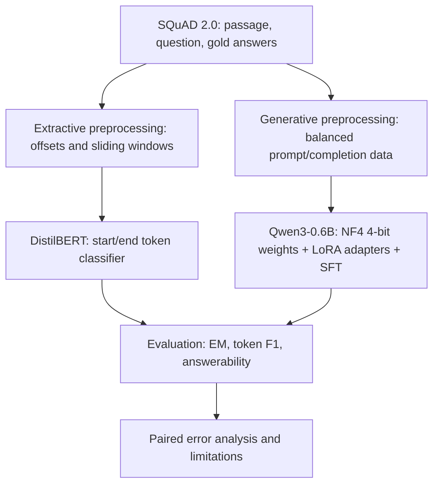

# Transformer-Based Question Answering
### DistilBERT · Qwen3-0.6B · 4-bit QLoRA

**Extractive vs. Generative Question Answering on SQuAD 2.0**

[Open Notebook](Transformer_Based_Question_Answering_System.ipynb) · [Run in Colab](https://colab.research.google.com/github/EighthhDayy/Transformer-Based-Question-Answering-System/blob/main/Transformer_Based_Question_Answering_System.ipynb) · [Reproduction Guide](docs/COLAB_RUN_GUIDE.md)

## Overview

This research prototype compares two approaches to passage-grounded question answering, including the ability to abstain when evidence is missing:

| Track | Model | Method | Output |
|---|---|---|---|
| Extractive QA | `distilbert-base-uncased` | Supervised start/end span prediction | Span copied from context, or no answer |
| Generative QA | `Qwen/Qwen3-0.6B` | Supervised fine-tuning (SFT) with NF4 4-bit QLoRA | Short grounded answer, or explicit abstention |

**Dataset:** SQuAD 2.0.

## Architecture

The models are **two alternative QA approaches**. DistilBERT uses extractive span decoding and a no-answer score, while Qwen3 directly generates an answer or a fixed abstention phrase.

## Qwen3 QLoRA pilot — observed results

**Hardware:** NVIDIA Tesla T4. **Training:** 300 SQuAD 2.0 examples (150 answerable and 150 unanswerable), one epoch, 38 optimizer steps, batch size 1, gradient accumulation 8, learning rate 2e-4, NF4 quantization, LoRA, completion-only loss, non-thinking chat template.

| Training observation | Value |
|---|---:|
| Training time | 218.5 s |
| PyTorch peak allocated CUDA memory | 1.28 GiB |
| Reported training loss | 0.2968 |
| Validation loss | 0.4616 |
| Mean token accuracy (training log) | 86.32% |

### Base vs. QLoRA-adapted Qwen3

40 answerable + 40 unanswerable validation examples, deterministic greedy generation.

| Metric | Base Qwen3 | QLoRA fine-tuned |
|---|---:|---:|
| Overall Exact Match | 16.25% | 56.25% |
| Overall Token F1 | 29.20% | 60.44% |
| Answerable Exact Match | 2.50% | 22.50% |
| Answerable Token F1 | 28.40% | 30.87% |
| No-answer recall | 30.00% | 90.00% |
| False abstentions / 40 answerable | 6 | 25 |

**Interpretation:** Fine-tuning improved overall EM/F1 and no-answer recall on this pilot, but also raised false abstentions from 6 to 25. In paired analysis, 20 answerable questions changed from an attempted answer to refusal; 13 had nonzero base-model token F1. This is an observed tradeoff, **not proof of causation or generalization**. The earlier 58.75% EM / 62.31% F1 run was not identical to the subsequent comparison output (56.25% / 60.44%).

## DistilBERT extractive track

The notebook implements fast-tokenizer offset mapping, 384-token context windows with a stride of 128, supervised start/end span labeling, and an explicit CLS-based null-answer decision. Earlier recorded three-epoch training logs:

| Epoch | Training loss | Validation loss |
|---|---:|---:|
| 1 | 3.7852 | 4.3144 |
| 2 | 3.0676 | 4.0230 |
| 3 | 2.6576 | 3.8841 |

These are **archived training logs** and are not DistilBERT EM/F1. A fine-tuned DistilBERT checkpoint must be loaded and evaluated to report extractive QA scores. **No unverified DistilBERT EM/F1 is invented here.**

## Reproducibility

1. Open the notebook in Google Colab with a CUDA GPU (T4 supported for the Qwen3 path).
2. Use the **pinned Hugging Face dependency versions** in the notebook setup cell, then restart the session if needed. Run data loading again after a restart.
3. Run the DistilBERT pipeline, or set `RUN_QWEN_QLORA = True` for the Qwen3 path.
4. Qwen3 saves a PEFT adapter to `./qwen3_qlora_adapter`; DistilBERT saves its checkpoint to `./squad_finetuned_model`. Back them up before Colab discards the runtime.
5. Evaluate on identified validation sample IDs and report actual generated scores; never treat archived output as proof that a fresh run passed.

[Full Colab run guide](docs/COLAB_RUN_GUIDE.md).

### Dependencies

The recommended versions for the Qwen3 experiment include `transformers==4.57.1`, `trl==0.23.1`, `peft==0.17.1`, and `huggingface-hub==0.36.2`. The original root `requirements.txt` is a historical Colab environment snapshot, **not** a portable lockfile.

## Findings

- The 300-example training supervision audit found **300/300 complete completion targets**, with 150 examples per class.
- Inspection found matching Qwen3 chat prompt formats for training and inference on sampled records.

## Scope and project status

**Completed:** Qwen3 QLoRA pilot training, inference, base-vs-adapter evaluation, error analysis.  
**To verify before claiming fully reproducible dual-model results:** final DistilBERT EM/F1 and an end-to-end clean-runtime notebook run.  
**Not claimed:** hosted demo, production deployment, full SQuAD benchmark, or demonstrated QLoRA speedups.
